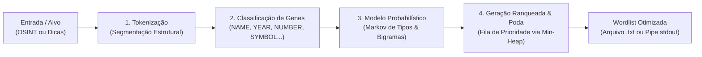

# CypherDNA
### Núcleo de Sequenciamento Genético de Senhas e Inteligência Avançada

[](https://github.com/Biiliiee/CypherDNA/actions/workflows/tests.yml)


**CypherDNA** é um motor forense open-source e de alta performance para analisar, mutar e gerar wordlists direcionadas de altíssima precisão. Ele usa **Sequenciamento Genético de Senhas** para identificar padrões estruturais, entropia e tendências comportamentais humanas na criação de senhas.

---

## Principais Funcionalidades

* **Análise de DNA de Senhas (`analyze`)** — Decompõe senhas em genes estruturais (`NAME`, `YEAR`, `NUMBER`, `SYMBOL`), calcula a entropia e estima o tempo de quebra por GPU.
* **Gerador de Alta Performance (`generator`)** — Motor com poda em heap, capaz de gerar milhões de senhas direcionadas com leet speak, símbolos, apelidos e tokens customizados.
* **Gerenciador de Tokens Customizados (`token`)** — Gerencie wordlists de domínios pessoais (ex: `NARUTOCHARACTER`, `GAMES`, `FOOTBALL`).
* **Ranker Estratégico (`ranker`)** — Customize regras de prioridade estrutural (`NAME+YEAR+SYMBOL`) pra ordenar o gerador.
* **Modelo Probabilístico (`collect`)** — Treine matrizes de transição probabilística a partir de vazamentos reais (ex: `rockyou.txt`).
* **Comparador de Wordlists (`comparator`)** — Avalia o realismo estrutural de wordlists prontas com base no modelo treinado.
* **100% Offline & Open-Source** — Zero chamadas pra nuvem, zero telemetria, zero rastreamento.

---

## Instalação

### Opção A — Executável Pronto (sem precisar de Python)
> Ideal para pentesters e usuários não técnicos.

1. Vá até a aba [**Releases**](https://github.com/Biiliiee/CypherDNA/releases).
2. Baixe `cypherdna.exe` (Windows) ou `cypherdna` (Linux).
3. Execute diretamente:

```bash
# Windows
cypherdna.exe analyze "Admin123!"

# Linux
./cypherdna analyze "Admin123!"
```

---

### Opção B — Instalar a partir do código-fonte (Desenvolvedor / Avançado)
> Instala o comando `cypherdna` globalmente via pip.

```bash
# 1. Clona o repositório
git clone https://github.com/Biiliiee/CypherDNA.git
cd CypherDNA

# 2. Instala o pacote (registra o comando 'cypherdna' globalmente)
pip install -e .

# 3. Use de qualquer lugar no terminal
cypherdna --help
```

---

## Exemplos de Uso

```bash
# Analisa a estrutura de DNA e a entropia de uma senha
cypherdna analyze "xbox360.kabuto"

# Gera uma wordlist direcionada (leet speak + símbolos, máximo 50 mil senhas)
cypherdna generator xbox kabuto 2024 -L -S -N 50000 -o alvo.txt

# Envia a saída direto pro Hashcat (sem gravar em disco)
cypherdna generator admin 2024 --pipe | hashcat -m 1000 hashes.txt

# Gerencia uma categoria de token customizado
cypherdna token GAME -a meus_jogos.txt

# Treina o modelo com uma wordlist real
cypherdna collect -i rockyou.txt

# Roda o diagnóstico do sistema
cypherdna doctor
```

---

## Gerando o Executável (a partir do código-fonte)

```bash
python scripts/build.py
# Saída: dist/cypherdna.exe
```

---

## Pipeline de Arquitetura

O CypherDNA opera através de um pipeline sequencial estruturado em 4 fases, transformando informações esparsas de inteligência em listas de senhas de altíssima probabilidade matemática:



1. **Tokenização (`core/dna_parser.py`)**: Decompõe dados brutos em fragmentos atômicos, identificando nomes, anos (1900–presente), datas completas, repetições, meses, estações, weak words e sequências de teclado (*key walks*).
2. **Classificação de Genes & Mutação**: Normaliza caracteres acentuados (Unicode NFKD/ASCII) e gera mutações direcionadas (case alternado, leet speak graduado, abreviações e sufixos/diminutivos fonéticos regionais).
3. **Modelo Probabilístico (`core/probabilistic_model.py`)**: Aplica matrizes de transição bigrama baseadas em cadeias de Markov calculadas a partir de vazamentos reais (como `rockyou.txt`), computando a probabilidade estatística de sequências (ex: `NAME+YEAR` vs `SYMBOL+NAME`).
4. **Geração Ranqueada com Poda via Heap (`core/Gen.py`)**: Utiliza uma fila de prioridade (*min-heap*) para manter em memória apenas as *N* combinações de maior probabilidade, aplicando penalidades comportamentais (ex: descarte de anos duplicados e restrição a anos sintéticos) com consumo mínimo de recursos.

---

## Motor de Inteligência de Vazamentos (`breach_engine.py`)

O módulo forense de inteligência em vazamentos foi projetado com rígidos padrões de segurança e privacidade:

* **Auditoria de Senhas via k-Anonymity (HIBP)**: A senha do usuário **nunca sai da máquina local** e jamais trafega em texto claro pela rede. O CypherDNA calcula o hash SHA-1 localmente, extrai apenas os primeiros 5 caracteres hexadecimais (prefixo) e consulta a API HaveIBeenPwned (`api.pwnedpasswords.com/range/{prefix}`). A lista de sufixos retornada pelo serviço é comparada localmente em memória, garantindo total privacidade e conformidade com auditorias de segurança.
* **Detecção Forense de E-mails**:
  * **Hudson Rock Cavalier OSINT (Tempo Real)**: Detecta infecções ativas por *infostealers* (malwares do tipo RedLine, Vidar, Lumma, Raccoon) e computadores comprometidos que continham credenciais corporativas daquele e-mail, sem necessidade de chaves de API pagas.
  * **HaveIBeenPwned API v3**: Identifica histórico de vazamentos corporativos e incidentes em serviços web (ativado automaticamente quando a chave `HIBP_API_KEY` estiver configurada no ambiente).

---

## Como Rodar os Testes

O projeto conta com suítes automatizadas de testes unitários e de integração de ponta a ponta:

```bash
# Suíte completa de testes unitários (Pytest)
pytest tests/

# Suíte de verificação de integridade operacional dos 7 módulos
python scripts/healthcheck_suite.py
```

---

## Arquitetura do Projeto

```
cypherdna/
├── .github/workflows/ # Matriz de CI do GitHub Actions (Python 3.10, 3.11, 3.12)
├── assets/          # Ícones e identidade visual
├── core/            # Motor forense de sequenciamento genético
│   └── commands/    # Handlers modulares dos comandos da CLI
├── data/            # Datasets embutidos, categorias de token e estratégias
├── lab/             # Servidor de demonstração e laboratório de quebra local
├── output/          # Destino padrão das wordlists e relatórios gerados
├── scripts/         # Build automatizado, instalação e suíte de healthcheck
├── tests/           # Suíte de testes unitários (dna_parser, crypto, Gen, probabilistic)
├── cli.py           # Ponto de entrada principal da CLI
├── pyproject.toml   # Especificação do pacote (PEP 621) e configuração do pytest
├── README.md        # Documentação
└── requirements.txt # Dependências
```

---

## Aviso Legal
Esta ferramenta é destinada **exclusivamente a testes de segurança autorizados, perícia digital e fins educacionais**. O uso contra sistemas que você não possui ou não tem permissão explícita para testar é ilegal e antiético. Os autores não se responsabilizam por uso indevido.

---

© 2026 CypherDNA — Núcleo de Inteligência Open Source
